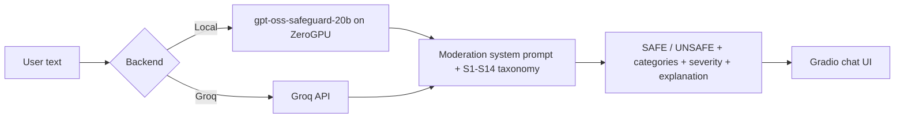

# 🛡️ HarmLens: AI Content Moderation

An AI-powered content moderation tool that analyzes text against a **14-category harm taxonomy** and returns a clear **SAFE / UNSAFE** verdict, the violated category codes, a severity level, and a written explanation.

Built with **Gradio** and **[gpt-oss-safeguard-20b](https://huggingface.co/openai/gpt-oss-safeguard-20b)**. Runs on **Hugging Face ZeroGPU** or through the **Groq API**.

[](https://huggingface.co/spaces/tashrifrahman/harmlens-content-moderation)


<p align="center">
  
</p>

---

## ✨ Features

- **14-category harm taxonomy (S1–S14):** violent crimes, non-violent crimes, sex-related crimes, child safety, defamation, specialized advice, privacy, intellectual property, indiscriminate weapons, hate, suicide & self-harm, sexual content, elections, and code interpreter abuse.
- **Structured verdicts:** SAFE / UNSAFE, all applicable category codes, severity (LOW, MEDIUM, HIGH, CRITICAL), and a reasoned explanation for each flag.
- **Two interchangeable backends:**
  - **Local model on ZeroGPU:** no API key required.
  - **Groq API:** fast hosted inference, with your own key.
- **Graceful fallback:** if the local model cannot load, the app still starts and falls back to the Groq backend.
- **Built-in examples** covering each category, plus a taxonomy reference panel in the UI.
- **Secure by default:** API keys are entered in a password field or read from the `GROQ_API_KEY` environment variable and are never stored.

## 🧰 Tech Stack

| Layer | Technology |
|---|---|
| Model | `openai/gpt-oss-safeguard-20b` |
| UI | Gradio |
| Local inference | Hugging Face Transformers, PyTorch, ZeroGPU (`spaces`) |
| Hosted inference | Groq API |
| Deployment | Hugging Face Spaces |

## 🏗️ How It Works



1. The user submits text in the Gradio interface.
2. A moderation **system prompt** that defines the full S1–S14 taxonomy is combined with the text.
3. The selected backend runs the model. On ZeroGPU, the `@spaces.GPU` decorator allocates a GPU only for the duration of the call.
4. The model's final answer is extracted (the reasoning channel is removed) and shown in the chat.

## 🚀 Run Locally

```bash
# 1. Clone the repository
git clone https://github.com/tashrifrahman/harmlens-content-moderation.git
cd harmlens-content-moderation

# 2. (Recommended) create a virtual environment
python -m venv venv
source venv/bin/activate        # Windows: venv\Scripts\activate

# 3. Install dependencies
pip install -r requirements.txt

# 4. (Optional) set your Groq API key
export GROQ_API_KEY="gsk_..."   # Windows PowerShell: $env:GROQ_API_KEY="gsk_..."

# 5. Launch
python app.py
```

> **Note:** The local backend needs a CUDA GPU with enough memory for a 20B-parameter model. Without one, choose the **Groq API** backend. Get a free key at [console.groq.com/keys](https://console.groq.com/keys).

## ☁️ Deploy on Hugging Face Spaces

1. Create a new Space with the **Gradio** SDK and **ZeroGPU** hardware.
2. Upload `app.py` and `requirements.txt`.
3. *(Optional)* Add `GROQ_API_KEY` under **Settings → Variables and secrets**.
4. The Space builds and launches automatically.

## 📁 Project Structure

```
harmlens-content-moderation/
├── app.py              # Gradio app, model loading, moderation logic
├── requirements.txt    # Python dependencies
├── assets/             # Demo GIF and screenshots
├── LICENSE
└── README.md
```

## ⚠️ Limitations & Responsible Use

- This is a **demonstration project**, not a production-ready safety system.
- LLM-based moderation can produce **false positives and false negatives**, and results can vary between runs.
- Context, sarcasm, and cultural or language differences can affect accuracy. Performance on languages other than English has not been evaluated.
- Always keep **human review** in the loop for real moderation decisions.

## 🗺️ Roadmap

- [ ] Batch moderation from CSV files
- [ ] Bangla and multilingual evaluation
- [ ] Configurable policies (custom taxonomy)
- [ ] Moderation history export (JSON/CSV)
- [ ] Benchmarking against labeled datasets

## 🙏 Acknowledgements

- [OpenAI gpt-oss-safeguard](https://huggingface.co/openai/gpt-oss-safeguard-20b) for the safety reasoning model
- [Groq](https://groq.com) for fast hosted inference
- [Gradio](https://www.gradio.app) and [Hugging Face](https://huggingface.co) for the UI framework and hosting

## 📄 License

Released under the [MIT License](LICENSE). The underlying model is subject to its own license on its Hugging Face model page.

## 👤 Author

**Md.Tashrif Rahman**
CSE student · Machine Learning & NLP

[](https://www.linkedin.com/in/md-tashrif-rahman)
[](https://github.com/tashrifrahman)

⭐ If you find this project useful, consider giving it a star!
